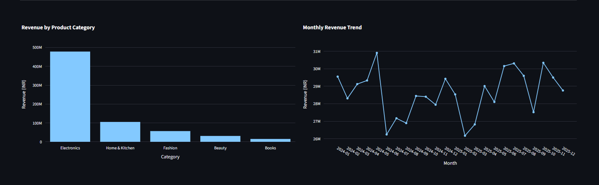

# E-Commerce Sales Analytics Dashboard

## Live Dashboard

🚀 **[Click Here to View the Live Dashboard](https://supreet-ecommerce-analytics.streamlit.app/)**

Explore interactive sales analytics, customer segmentation,
revenue trends, and automated business insights.


## Project Overview

An interactive E-Commerce Sales Analytics Dashboard developed using Python, Pandas, NumPy, Plotly, and Streamlit.

The project analyzes e-commerce transactions to understand sales performance, revenue trends, profitability, customer behavior, and regional performance. It also generates automated business insights to support data-driven decision-making.

## Project Objectives

- Clean and preprocess e-commerce datasets.
- Analyze sales revenue, profit, and order performance.
- Identify top-performing product categories.
- Analyze monthly and regional sales trends.
- Segment customers based on their purchasing value.
- Develop an interactive dashboard.
- Generate automated business insights and recommendations.

## Technologies Used

| Technology | Purpose |
|---|---|
| Python | Data processing, analysis, and dashboard development |
| Pandas | Data cleaning, manipulation, filtering, and aggregation |
| NumPy | Numerical calculations and data processing |
| Plotly | Interactive charts and visualizations |
| Streamlit | Interactive web dashboard development |
| VS Code | Writing, debugging, and executing code |
| Git | Version control and tracking code changes |
| GitHub | Project hosting and sharing |

## Dashboard Features

- Interactive category and date filters
- Total revenue, profit, orders, and profit margin KPIs
- Category-wise revenue analysis
- Monthly sales trend visualization
- Regional sales performance analysis
- Customer segmentation dashboard
- Automated business insights and recommendations
- Downloadable filtered sales reports

## Dataset

The project uses e-commerce datasets containing information about customers, orders, and products.

The data is cleaned and processed before performing exploratory data analysis and dashboard visualization.

## Project Workflow

1. Data collection
2. Data cleaning and preprocessing
3. Exploratory Data Analysis (EDA)
4. Sales and profit analysis
5. Customer segmentation
6. Interactive dashboard development
7. Automated business insights
8. Dashboard testing and validation

## Key Business Insights

The analysis identified Electronics as a leading revenue-generating and profitable category, with the Central region performing strongly in the tested dashboard view.

The dashboard also helps identify lower-performing categories, compare regional performance, and understand customer value segments.

Insights update according to the selected filters.

## How to Run the Project

**Step 1:** Clone the repository.

```bash
git clone https://github.com/supreet088/Ecommerce-Sales-Analytics-Dashboard.git
```

**Step 2:** Open the project directory.

```bash
cd Ecommerce-Sales-Analytics-Dashboard
```

**Step 3:** Install dependencies.

```bash
pip install -r requirements.txt
```

**Step 4:** Launch the Streamlit dashboard.

```bash
python -m streamlit run dashboard.py
```

## Future Enhancements

- Sales forecasting using machine learning
- Real-time database integration
- Advanced customer behavior analysis
- Product recommendation system
- Cloud deployment

## Conclusion

This project demonstrates practical skills in Python programming, data cleaning, exploratory data analysis, interactive visualization, and business intelligence.

The dashboard transforms e-commerce transaction data into meaningful visual reports and actionable business insights.


## Dashboard Screenshots

### Dashboard Overview


### Revenue Analysis


### Regional Analysis


### Customer Segmentation


### Business Insights and Recommendations


## Author

**Supreet**

GitHub: [supreet088](https://github.com/supreet088)


